**Repository:** `github.com/samsamthecodingman/MMA3001_project` (code, HTML documentation in `docs/`, test report in `reports/test_report.html`, decision log `DECISIONS.md`, AI-use statement `AI_USE.md`).

# 1. Engineering problem

**Context.** HVAC is typically the largest energy end-use in university buildings. Most systems ventilate to a fixed schedule that assumes design occupancy. *Demand-controlled ventilation* (DCV) instead scales outdoor-air supply to the number of people actually present. It needs a reliable occupancy estimate for every zone. Dedicated people-counters are expensive and are installed in only a few spaces. Low-cost environmental (CO₂/temperature/humidity) sensors are far more common.

**Problem addressed.** Can the environmental sensors already installed in the Monash Smart Infrastructure (MSI) buildings act as a *virtual occupancy sensor*: estimate the number of occupants in a zone every 15 minutes, validated against the building's people-counters?

**Why it matters.** A credible virtual sensor would let a facility manager drive ventilation and space-utilisation decisions from existing hardware. To be credible, it needs a quantified error and a known operating envelope.

**Intended use.** Use the estimates for zone-level ventilation scheduling and utilisation reporting (15-min resolution, errors of ±1–2 people acceptable). They are *not* meant for safety-critical counting such as fire-egress limits.

**Scope and its limits.** The project compares a physics-based estimator (single-zone CO₂ mass balance), a schedule baseline, and five ML regressors, plus physics/ML hybrids. It does not do online control. Section 2 explains that the usable real data reduced to **one co-located sensor/space pair** (27 days) plus two control pairs. Conclusions about generalisation to other rooms are therefore limited (Section 7).

# 2. Inputs, outputs and data

## 2.1 Top-level inputs and outputs

| | Quantity | Format / units | Domain |
|---|---|---|---|
| **Input** | CO₂ concentration | ppm, float, irregular timestamps (~10 min) | 350–5000 ppm (else flagged invalid) |
| Input | Temperature, relative humidity | °C, % | 5–45 °C, 0–100 % |
| Input | Timestamp | tz-aware, Australia/Melbourne | — |
| **Ground truth** (training/validation only) | Headcount events from the occupancy counter | persons, integer, event stream (median gap 2–4 s) | 0–72 observed |
| **Output** | Estimated occupancy per 15-min interval | persons, float ≥ 0 | 0–~40 |
| Output | Occupied flag | boolean (estimate > 0.5 persons) | — |
| Output | Calibrated zone parameters (physics model) | effective volume V [m³], outdoor-air flow Q [m³/s], supply CO₂ C_out [ppm] | V, Q > 0 |

**Invalid, missing or unsupported inputs.**

- Physically implausible readings are set to NaN (ranges in `occupancy.io.VALID_RANGES`).
- Exact re-sent payloads are dropped.
- "Frozen" sensors, with fewer than 100 unique timestamps, are excluded.
- Gaps longer than 45 min are not interpolated, and no estimate is produced inside them.
- Occupancy intervals with less than 50 % counter coverage are dropped. A counter silent for more than 30 min is treated as offline, not as "unchanged".
- Calibration raises an error if it yields non-physical parameters (V ≤ 0 or Q ≤ 0). For example, a room that is never occupied does not excite the dynamics.

Function-level inputs and outputs are documented in the docstrings and the generated HTML documentation (`docs/`).

## 2.2 Data audit

The teaching team provided two exports: environmental sensors (179 447 rows, JSON payload per row) and occupancy counters (9.09 M event rows, 5 floor-spaces). The audit (`scripts/ingest.py`, Fig. 1) found three problems.

1. **Most env rows are duplicates.** 3 of the 5 env sensors are *frozen*: they re-send a single payload 11 k–59 k times, with 1–2 unique timestamps. In total, 136 604 of 179 447 rows are duplicates. Only two sensors carry live 10-min data: `…0869` (located in G.38, Building 60; Feb–Jun 2024) and `…0326` (not in the location sheet; Sep 2025–Apr 2026).
2. **The location metadata does not link sensors to counters.** The location sheet maps neither live env sensor to a counted space. Its occupancy tab is labelled "SpaceFloorIDs Invalid", and only 2 of the 5 counter IDs appear in it at all.
3. **The counters are reliable but intermittent.** Counts are integers with plausible ranges. However, there are 1 000–4 700 silences longer than 30 min per space, so the hold cap above is needed.

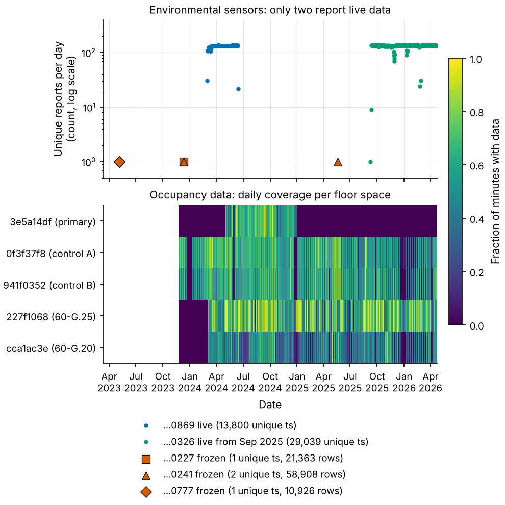{width=85%}

**Associating sensors with spaces from data.** The metadata could not be trusted, so I correlated each live sensor's CO₂ with each space's headcount on the common 15-min grid. Both series first had their own *time-of-week mean* removed. Without this step, any two series that are high during office hours would correlate.

Sensor `…0869` and space `3e5a14df` had a residual correlation of r = 0.64 over 27 days, far above every other pair (Fig. 2). This pair is taken as **co-located (primary)**. Two weaker pairs (r = 0.40, 0.32) are kept as **controls**. Sensor `…0326` correlates with nothing (|r| ≤ 0.03).

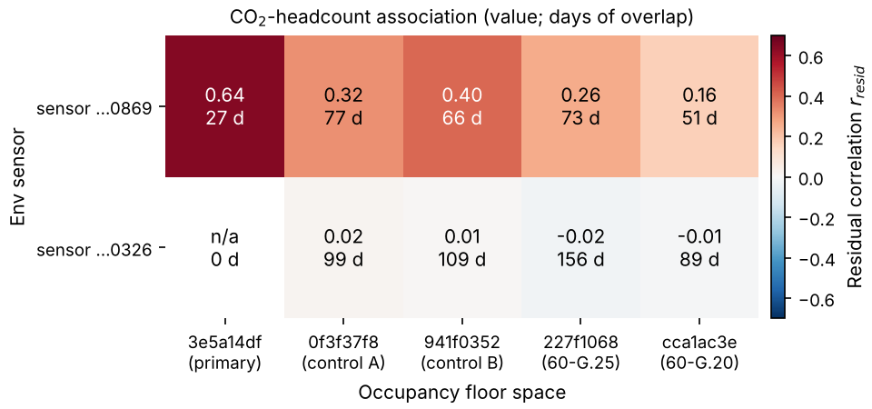{width=70%}

The "Example Data (Do not use)" files were not used, as instructed by the teaching team.

# 3. Computational approach

## 3.1 Pre-processing (interpolation and integration)

**Env channels.** CO₂, temperature and humidity are continuous fields, so they are *interpolated* onto a uniform 15-min grid. Linear interpolation was chosen by a hold-out test on the real CO₂ record: random observations were withheld (10–50 %) and predicted from the rest.

| Method | Hold-out MAE |
|---|---|
| Linear | 7.9–8.4 ppm |
| PCHIP | about 0.3 ppm worse than linear |
| Nearest-neighbour | 9.3–9.8 ppm |
| Natural cubic spline | 10.0–11.2 ppm (overshoots on noisy data) |

Gaps longer than 45 min are left empty.

**Headcount.** Headcount is a *state reported at events*, so it must be averaged over each interval, not interpolated. The 15-min mean is the time integral of the zero-order-hold signal divided by the covered time.

A first implementation looped over events in Python. The final version (`io.occupancy_on_grid`) evaluates a cumulative integral at the grid edges in vectorised NumPy:

$$I(x)=S_k+w_k h_k (x-t_k),\qquad S_k=\textstyle\sum_{j<k} w_j h_j d_j .$$

This aggregates 1.5–2.2 M events per space in 0.1–0.4 s. Both versions agree to 1e-9 on random event streams and on a hand-calculated case (`tests/test_io.py`).

**Target alignment.** CO₂ is an instantaneous sample, whereas the target is an interval mean. Labelling the mean over $[t,t+\Delta t)$ at $t$ makes occupancy *lead* CO₂ by Δt/2. The synthetic study (§4) showed this biases the calibrated volume by +31–52 % at Δt = 15 min. The target is therefore **centred**, $[t-\Delta t/2,\,t+\Delta t/2)$, which reduced the bias to +2–19 %.

## 3.2 Physics-based estimator (ODE, finite differences, least squares)

The zone is modelled as a single well-mixed control volume:

$$V\frac{dC}{dt}=10^6\,g\,N(t)-Q\,(C-C_\text{out}).$$

Here $g=5.2\times10^{-6}$ m³/s per person is the CO₂ generation of a sedentary adult [1, 2].

- **Forward problem (verification and simulation).** Three solvers are implemented: explicit Euler, classical RK4, and the exact solution for piecewise-constant $N$. On a uniform grid, the exact update $C_{k+1}=aC_k+(1-a)C_{ss,k}$, with $a=e^{-\Delta t/\tau}$ and $\tau=V/Q$, is a first-order IIR filter evaluated with `scipy.signal.lfilter`.
- **Inverse problem (the estimator).** $\hat N=\big(V\,\dot C+Q(C-C_\text{out})\big)/(10^6 g)$. The derivative $\dot C$ comes from a finite-difference scheme: backward (1st order), central (2nd order) or Savitzky–Golay (local quadratic fit, window 5), applied run-by-run so gaps do not contaminate neighbours.
- **Calibration.** The model is linear in $(V,\,Q,\,QC_\text{out})$, so $N=a\dot C+bC+c$ is solved by ordinary least squares on training data. This gives $V=10^6ga$, $Q=10^6gb$ and $C_\text{out}=-c/b$. Calibration is one $n\times3$ least-squares solve: closed form, unique, and fast (2 ms).
- **Assumptions.** Perfect mixing; constant Q and C_out within the calibration window; constant per-person generation; no other CO₂ sources or sinks; the sensor represents the zone.

## 3.3 Data-driven and hybrid models

All models are scikit-learn regressors on **causal** features, so they could run in real time:

- CO₂ and its first difference at lags 0–3;
- CO₂ above a rolling 24-h 5th-percentile baseline;
- temperature, humidity and their differences;
- hour of day (sin/cos);
- weekend flag.

| Model | Configuration |
|---|---|
| Ridge linear regression | Linear, regularised |
| Decision tree | depth 8, min-leaf 20 |
| Random forest | 200 trees, depth 12, min-leaf 10 |
| SVR | RBF kernel |
| MLP | 64-32 ReLU, L2 = 1e-3, Adam, early stopping |

**Baseline.** The *time-of-week mean*, which uses no sensor data, sets the bar any sensor-based model must clear.

**Hybrids.** The forest and MLP are also trained with the physics estimate as an extra feature.

## 3.4 Validation design

**Main protocol: blocked leave-one-week-out cross-validation.** Each calendar week is predicted by models trained on all *other* weeks. A 1-day buffer either side stops lagged and rolling features, and autocorrelation, from leaking across the boundary. Out-of-fold predictions are pooled and scored once.

**Why not other splits.**

- Random K-fold splitting would leak information between neighbouring samples.
- A purely chronological split was also run (60/20/20). Its 8-day test window fell entirely in the June exam period, where mean occupancy was 0.8 people against 3.7 in training. R² is meaningless on such low test variance. That split is therefore reported separately as a regime-shift scenario (§5.3).

**Metrics.**

- MAE in persons, the operator-relevant error;
- RMSE;
- R²;
- bias;
- F1 for the occupied/vacant state.

The validation folds did not influence the headline model settings. The defaults were fixed beforehand, and tuning is reported only as sensitivity (§6.2) to avoid optimistic selection bias.

# 4. Verification (does the code solve the equations correctly?)

Verification uses manufactured data where the truth is known exactly (`tests/`, `scripts/sensitivity_synthetic.py`).

- **Order of accuracy (Fig. 3).** Against the analytical solution, the observed global orders are 0.97 for Euler and 4.14 for RK4 (theory: 1 and 4).
- **Stability (Fig. A0).** Explicit Euler on $\dot C=-C/\tau+f$ has amplification factor $|1-\Delta t/\tau|$. It oscillates for Δt > τ and diverges for Δt > 2τ, exactly as predicted. Typical rooms have τ ≈ 20–60 min, so a 15-min explicit step is near the oscillation limit for small rooms. This is one reason the exact solution is used.
- **Inverse and calibration.** On noise-free data, the inverse recovers constant occupancy to ±0.05 persons. Calibration recovers V and Q within 5 % and C_out within 5 ppm.
- **End-to-end on synthetic rooms.** Four rooms were generated with irregular ~10-min sampling, 15 ppm noise and 3 % dropouts. Physics R² was 0.96, and the calibrated V and Q were within 4–17 % and 5 % of truth respectively.
- **Vectorisation.** The vectorised solver matches the loop to 1e-10.

All 23 unit tests pass (`reports/test_report.html`).

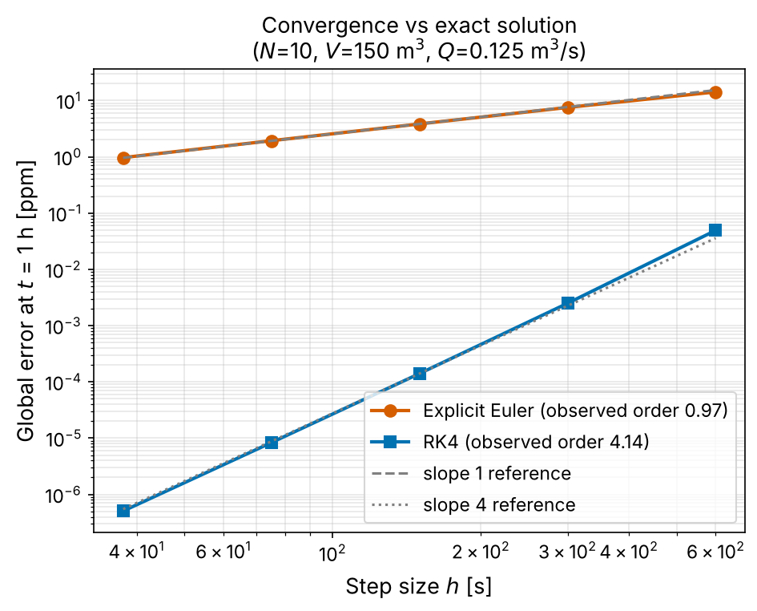{width=55%}

# 5. Validation on real data

## 5.1 Main result (blocked CV, primary pair, 7 folds, 2 615 intervals)

| Model | MAE [persons] | RMSE | R² | Bias | F1 (occupied) | Fit time per fold |
|---|---|---|---|---|---|---|
| Time-of-week baseline | 2.17 | 3.07 | 0.00 | +0.01 | 0.85 | 1 ms |
| **Physics (3 parameters)** | 1.55 | 2.24 | 0.47 | **+0.02** | 0.82 | **2 ms** |
| Linear (ridge) | 1.58 | 2.25 | 0.46 | +0.17 | 0.86 | 3 ms |
| SVR | 1.61 | 2.35 | 0.41 | +0.01 | 0.83 | 0.27 s |
| MLP 64-32 | 1.61 | 2.35 | 0.41 | +0.27 | 0.83 | 0.77 s |
| **Random forest** | **1.43** | **2.12** | **0.52** | +0.10 | **0.87** | 0.60 s |
| Forest + physics feature | 1.43 | 2.14 | 0.51 | +0.11 | 0.87 | 0.55 s |

**The sensor carries real information.** Every sensor-based model beats the schedule baseline. MAE falls by 0.56–0.75 persons (−26 % to −34 %), and R² rises from 0 to 0.41–0.52. On the two *control* pairs (sensor not co-located), the same forest reaches only R² = 0.27/0.41, against 0.15/0.27 for the baseline (Fig. 4). The gain is far smaller, which supports the claim that the primary pair measures room-level occupancy rather than building-wide activity.

**Physics versus black box.** The 3-parameter physics model is within 0.13 persons MAE of the best model. It has the smallest bias, and it fits 300× faster than the forest. The MLP is not better than linear regression on 2 600 samples of tabular data. Adding the physics estimate as a forest feature changed nothing, unlike on synthetic data, where it helped (MAE 0.15 → 0.10). On real data the forest already extracts the same CO₂-level information.

**Failure mode.** All models **under-predict peaks above ~10 people** (Fig. 5). The CO₂ at a sensor mounted high in a large workshop zone rises only 100–150 ppm for 15 occupants, because the effective volume is large. Accuracy at high occupancy is therefore limited by physics, not by the model class.

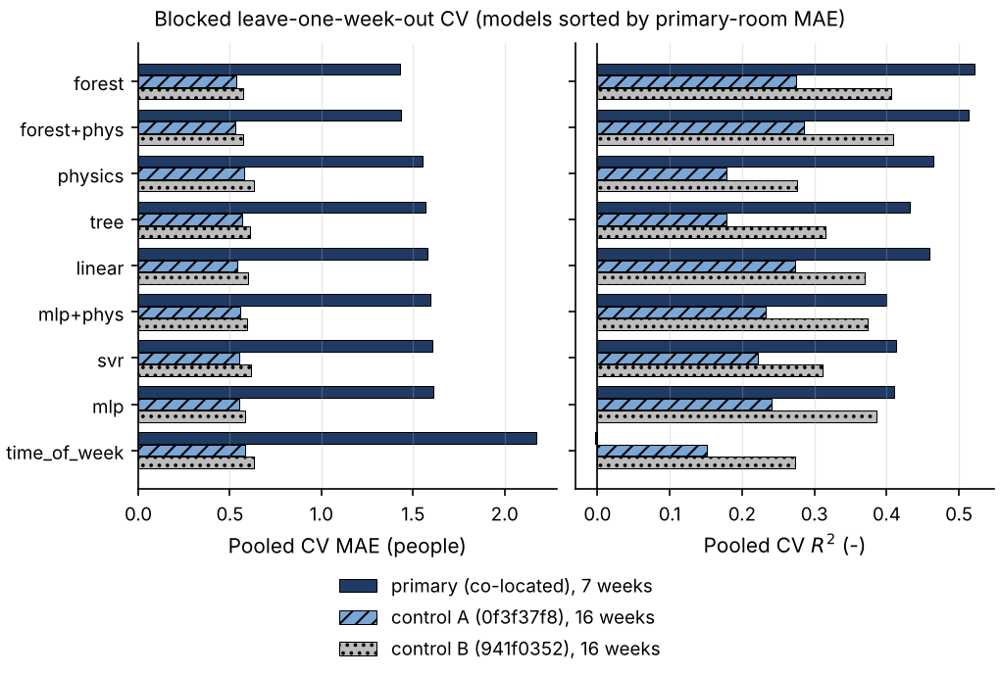{width=80%}

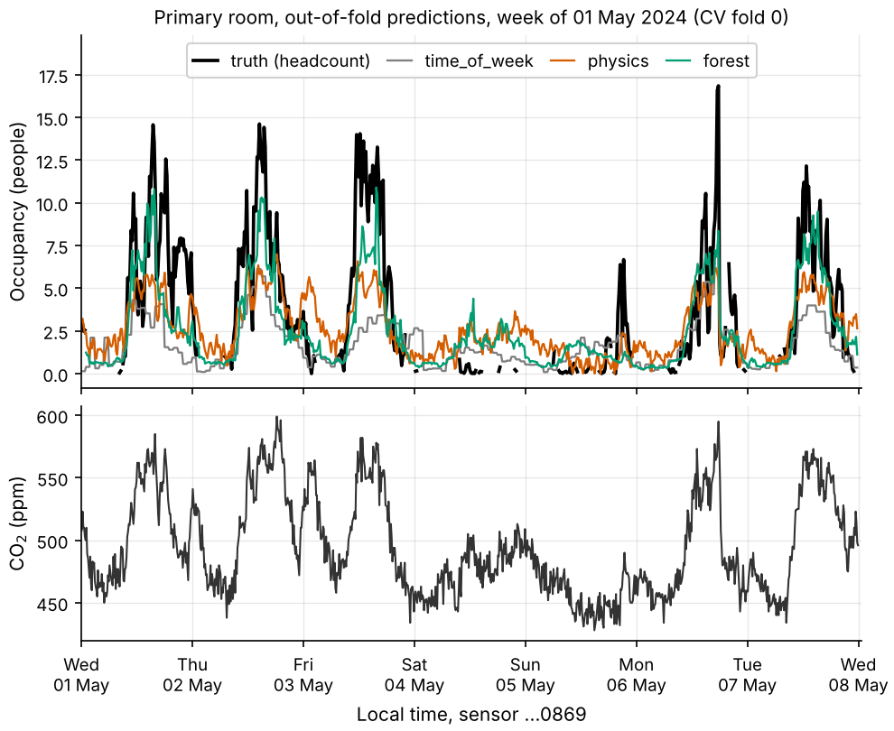{width=78%}

## 5.2 What the validation cannot establish

- **Single site.** There is only one co-located pair, with 27 days in one season. Accuracy in other rooms, other ventilation regimes (e.g. winter heating), or with occupancy far outside 0–17 is untested.
- **Uncertain pairing.** The co-location is *inferred* statistically, not confirmed physically.
- **Imperfect ground truth.** The counter itself is not error-free. Its own error is unknown and is included in the reported MAE.
- **Overlapping folds.** CV folds share the same 6-week period, so the result is not a test of long-term drift.

## 5.3 Regime shift (chronological split)

When trained on May (teaching) and tested on 6–13 June (exams), the schedule baseline fails badly: MAE 2.12, because it predicts teaching-week occupancy. The CO₂-based models adapt (forest MAE 0.61, physics 0.82; Fig. 6). This is the practical argument for a sensor-based estimate over a timetable. A timetable cannot know that the semester has ended.

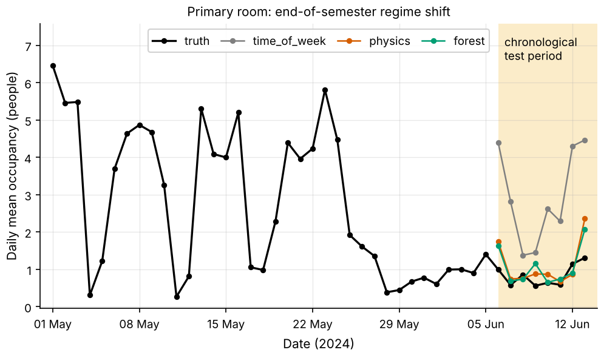{width=68%}

# 6. Sensitivity, optimisation and performance

## 6.1 Physics-model sensitivity

**Derivative scheme and grid spacing (Fig. 7a).**

- Prediction accuracy is almost insensitive to the derivative scheme (CV R² 0.44–0.48 across backward, central and Savitzky–Golay) and improves slightly at a 30-min grid.
- The backward-difference result at 15 min looks best, but is scored on only 5 of 7 folds; the other two calibrations were non-physical.

**Parameter identifiability.** The *identified* volume is not robust. V ranges from 25 to 670 m³ across schemes, whereas Q stays at ≈ 0.25 m³/s (≈ 250 L/s). The estimate is dominated by the steady-state term $Q(C-C_\text{out})$. With 10-min sampling and transients shorter than τ, the derivative term is poorly identified. Engineering consequence: the calibrated Q is a credible ventilation estimate, but V should not be read as a physical room volume.

**Generation rate g.** Predictions are exactly invariant to the assumed g; they differed by at most 4e-15 for g = 3.5–7.0 × 10⁻⁶ m³/s. Only the inferred V and Q scale with g. An uncertain metabolic rate therefore does not affect the occupancy estimate when the model is calibrated against counts.

**Synthetic sensitivity.**

- Sensor noise from 0 to 50 ppm raised MAE from 0.10 to 0.60 persons.
- Noise moved the V error from +23 % to −46 % and the Q error from 0 to −20 %. This is the classic errors-in-variables attenuation of least squares when the regressor (the noisy derivative) is itself measured with error.

## 6.2 Model selection and data requirement

**Hyper-parameter sweep.**

- Forest depth 4–∞ and leaf size 5–50: R² 0.515–0.543.
- MLP width 16–64-32 and L2 1e-4–1: R² 0.39–0.41.

The best forest is only 0.02 above the default, and it was selected on the same folds, so the defaults were kept.

**Learning curve (Fig. 7b).** Each fold's training set was subsampled to *n* labelled days.

- The physics model reaches R² = 0.44 ± 0.09 with **4 days** of labels.
- The forest needs about 14 days to reach a similar level (0.12 at 4 days, 0.42 at 14).

For commissioning a new room, the physics model's data efficiency matters more than the forest's final 0.05 R².

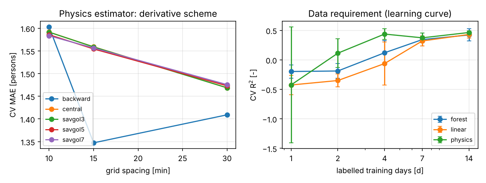{width=88%}

## 6.3 Computational performance

**Machine.** 4 vCPU Xeon @ 2.1 GHz with AVX-512 (2 FMA units).

- Theoretical peak: $F_T = 4 \times 2.1\,\text{GHz} \times (512/64)\times 4 = 269$ GFLOP/s.
- Measured dgemm: 188 GFLOP/s.
- Measured stream bandwidth: 8.4 GB/s.
- Machine balance ≈ 22 FLOP/byte.

| Method | FLOP / sample | Bytes / sample | Arithmetic intensity | Measured time (n = 10⁶) |
|---|---|---|---|---|
| RK4 step (Python loop) | 32 | 24 | 1.3 | 2 000 ns |
| Exact step, Python loop | 6 | 24 | 0.25 | 270 ns |
| **Exact step, `lfilter`** | 6 | 24 | 0.25 | **7.5 ns** |
| Inverse estimator (central) | 8 | 16 | 0.5 | 8.5 ns |
| Inverse estimator (Sav.–Golay) | 15 | 16 | 0.9 | 18 ns |
| MLP inference (24-64-32-1) | 7 300 | 200 | 37 | — |

**Physics estimator.** Its intensity (0.5–0.9 FLOP/B) is far below machine balance, so it is **memory-bound**. The roofline bound is about 2 ns/sample (16 B ÷ 8.4 GB/s). The measured 8.5 ns reflects NumPy temporaries, i.e. several passes over memory.

**MLP.** It is compute-bound when batched. It needs ~500× more FLOP per estimate than the physics model.

**Optimisation results.**

- Replacing the Python time-stepping loop with the IIR-filter form of the exact solution gave a **36× speed-up** over the exact loop, and 280× over the RK4 loop, with identical results (Fig. A1).
- Vectorising the occupancy aggregation turned a per-event Python loop into a cumulative-sum evaluation (0.1–0.4 s per 2 M events).
- Profiling with cProfile shows that the full experiment time is dominated by SVR and random-forest fitting inside CV, not by the numerical methods.

At building scale (hundreds of zones at 15-min resolution), every method is computationally trivial. The deciding criteria are therefore accuracy, data requirement and interpretability, not cost.

# 7. Limitations and lessons learned

**Limitations.**

1. **Narrow evidence base.** Real-data evidence rests on one inferred co-located pair over 27 days. This is the largest threat to external validity.
2. **Single-zone assumption.** The model assumes one well-mixed zone. A sensor mounted high in a large workshop sees a diluted, delayed signal, which is why every model under-predicts peaks.
3. **Latency.** The Savitzky–Golay derivative adds 30 min of latency.
4. **No uncertainty estimate.** No prediction intervals are produced, even though DCV control should use them.

**Lessons.**

1. **Data auditing changed the project.** 76 % of env rows were duplicates, and the metadata was wrong. The physical pairing of sensor and space had to be inferred from data, with controls to test that inference.
2. **Evaluation design mattered more than model choice.** A naive chronological split produced R² of −20 for the baseline and negative values for every model. The cause was an exam-period test window, not bad models. Blocked CV gave a fair picture.
3. **A small timing detail produced a large parameter bias.** Labelling the interval mean at its start biased V by +40 %; centring fixed it. Synthetic verification exposed the bug before real data could hide it.
4. **Simple models are hard to beat.** A 3-parameter physics model with one least-squares solve matched an MLP. It needs a quarter of the training data, and its parameter Q has engineering meaning.

**Proposed improvements, in priority order.**

1. Confirm the sensor–space pairing on site, and obtain co-located sensors for more rooms, to enable leave-one-room-out validation.
2. Add a two-zone or delayed-mixing model.
3. Fit an output-error (simulate-and-match) calibration with a Kalman-filter state estimator, giving uncertainty bounds and less noise sensitivity.
4. Use the physics model for commissioning and switch to a forest once more than 2 weeks of labels exist.

# 8. AI use (summary)

Full statement in `AI_USE.md`. AI tools (Anthropic Claude, via Claude Code) were used extensively, as the unit permits:

- planning;
- writing most of the code and tests;
- running analyses;
- drafting this report.

The student set the goal and constraints, selected the dataset, supplied the data, and is responsible for reviewing every decision in `DECISIONS.md` and every claim in this report. *[Student to complete: what you personally verified, which AI suggestions you rejected or changed, and how it affected your understanding — see AI_USE.md.]*

# References

[1] ASHRAE, *Standard 62.1-2022: Ventilation and Acceptable Indoor Air Quality*, Atlanta, 2022.
[2] A. Persily and L. de Jonge, "Carbon dioxide generation rates for building occupants," *Indoor Air*, 27(5), 868–879, 2017.
[3] Monash Smart Infrastructure, *MSI occupancy and environmental sensor exports (May–Dec 2024)*, provided for MMA3001, Monash University, 2026.
[4] P. Virtanen et al., "SciPy 1.0," *Nature Methods*, 17, 261–272, 2020.
[5] F. Pedregosa et al., "Scikit-learn: Machine learning in Python," *JMLR*, 12, 2825–2830, 2011.
[6] A. Savitzky and M. J. E. Golay, "Smoothing and differentiation of data by simplified least squares procedures," *Analytical Chemistry*, 36(8), 1627–1639, 1964.
[7] MMA3001 unit notes, weeks 2–11 (optimisation and profiling, interpolation, ML regression, finite differences, ODE stability), Monash University, 2026.

# Appendix A — additional figures

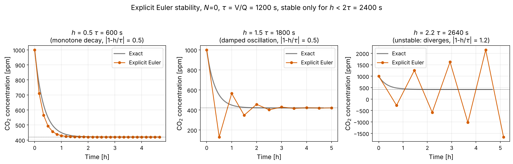{width=95%}

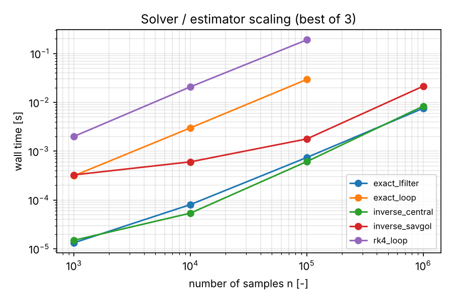{width=65%}

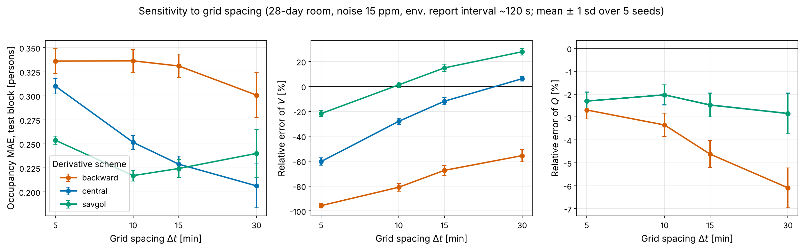{width=80%}

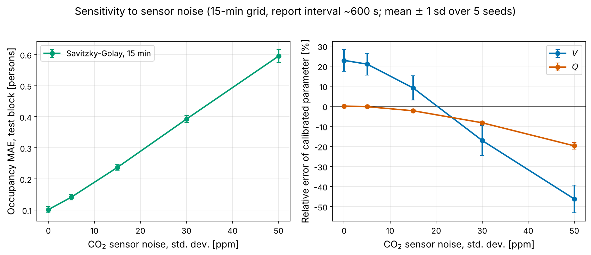{width=80%}

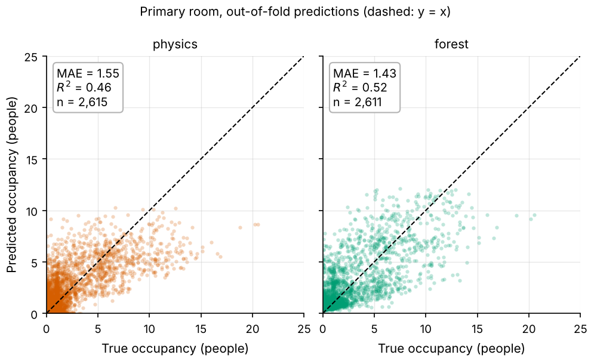{width=80%}

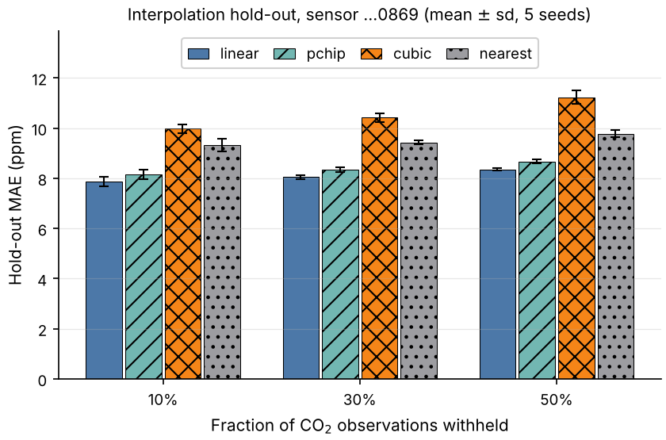{width=70%}
